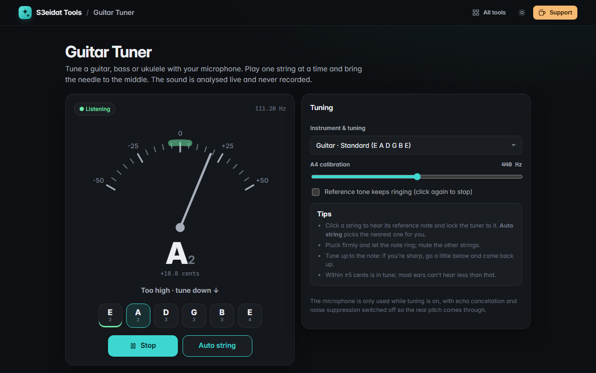

# Guitar Tuner

> Tune your guitar, bass or ukulele with your microphone. Free, private, and it runs entirely in your browser.

### ▶ [Open Guitar Tuner](https://s3eidat.github.io/guitar-tuner/)



## Features

- **Accurate pitch detection** (YIN autocorrelation) from your microphone, from low B on a 5-string bass up
- **Note name and a cents needle** with a green ±5-cent zone, plus "tune up / tune down" advice and the exact frequency
- **Auto string** picks the nearest string, or click a string to lock onto it
- **Reference tone** for every string (plucked, or ringing until you click again)
- Tunings: guitar **Standard, Drop D, DADGAD, Open G, Open D, half step down**; **bass** 4-string, 5-string, Drop D;
  **ukulele** GCEA; and a **chromatic** mode for any note
- **A4 calibration** from 430 to 450 Hz
- Remembers your tuning and calibration

## Privacy

The sound is analysed live in the page and never recorded or sent anywhere. There is no server, no account,
no analytics. The page ships with a strict Content-Security-Policy (`connect-src 'self'`), so the browser
itself blocks any attempt to send data anywhere. The microphone is only requested when you press **Start tuning**.

## Run it yourself

It's plain HTML, CSS and JavaScript with no build step:

```bash
git clone https://github.com/s3eidat/guitar-tuner
cd guitar-tuner
python -m http.server 8000
```

Then open http://localhost:8000 (the microphone needs `localhost` or HTTPS).

## Support

If this saved you time, **[buy me a coffee ☕](https://s3eidat.github.io/coffee/)**. It keeps every tool free.

---

Part of **[S3eidat Tools](https://s3eidat.github.io/)**: 100+ free, private tools that run in your browser. MIT licensed.
